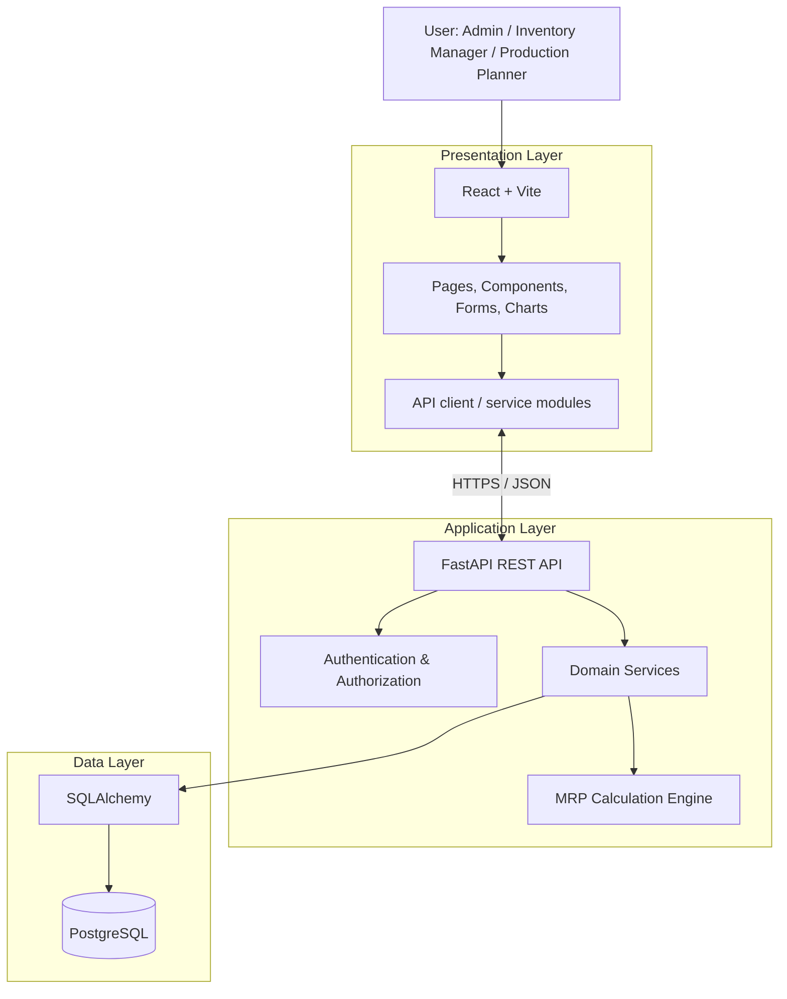
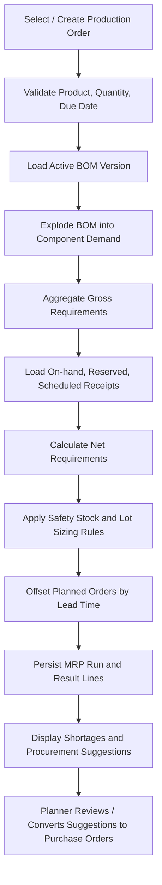
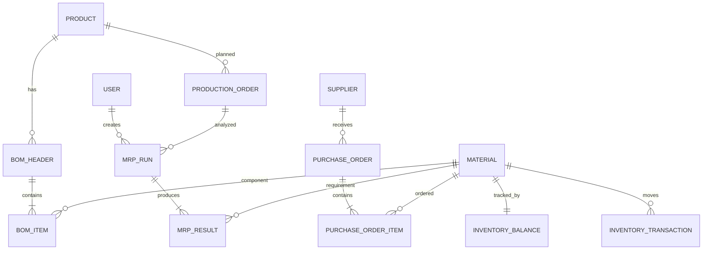

# Architecture — MRP Management System

**Document version:** 1.0  
**Project:** Material Requirements Planning (MRP) Management System  
**Architecture style:** Layered 3-tier architecture with modular backend services  
**Status:** Development baseline

---

## 1. Purpose

This document describes the architecture, components, responsibilities, data flow, and technical boundaries of the MRP Management System. It is intended to guide implementation in Google Antigravity and keep generated code consistent with the project's design.

## 2. System objectives

The application shall:

- Maintain product, material, supplier, inventory, and Bill of Materials (BOM) records.
- Accept production plans and calculate component demand.
- Perform BOM explosion and material netting.
- Account for on-hand inventory, reservations, and scheduled receipts.
- Identify shortages and produce procurement recommendations.
- Record inventory movements and purchasing activity.
- Provide dashboards and downloadable operational reports.
- Keep business calculations in the backend, not in the browser.

## 3. Architecture overview

The system uses a **3-tier architecture**:



### Request flow

1. A user performs an action in the React interface.
2. The frontend API client sends an HTTP request with JSON data.
3. FastAPI validates the request using Pydantic schemas.
4. The API route invokes the appropriate application/domain service.
5. The service applies business rules and reads/writes data through SQLAlchemy.
6. PostgreSQL commits the transaction when applicable.
7. FastAPI returns a validated JSON response.
8. React updates the view and displays success or error feedback.

## 4. Technology stack

| Concern | Technology | Responsibility |
|---|---|---|
| Frontend framework | React | Interactive user interface |
| Frontend tooling | Vite | Development server and build |
| Styling | Tailwind CSS | Responsive UI styling |
| Icons | Lucide React | Interface icons |
| Charts | Recharts | Dashboard visualizations |
| Backend framework | FastAPI | REST API and request routing |
| Validation | Pydantic | API input/output validation |
| ORM | SQLAlchemy 2.x | Database access and entity mapping |
| Database | PostgreSQL | Persistent relational storage |
| Migrations | Alembic | Version-controlled schema changes |
| Authentication | JWT (planned) | Stateless API authentication |
| Testing | Pytest + frontend test tooling | Unit and integration tests |
| Version control | Git / GitHub | Source control and collaboration |
| Optional packaging | Docker Compose | Reproducible local services |

> The starter currently uses SQLite as a local fallback. PostgreSQL is the target database for the full implementation. Configure the database through `DATABASE_URL`; never hard-code credentials.

## 5. Component responsibilities

### 5.1 Frontend

The frontend is responsible for presentation and user interaction only.

- Render pages, navigation, tables, forms, charts, and dialogs.
- Perform basic client-side usability checks.
- Call backend endpoints through centralized API modules.
- Display loading, empty, success, and error states.
- Never calculate authoritative MRP results or directly access the database.

Planned pages:

- Overview / Dashboard
- Materials
- Products
- BOM Editor
- Inventory
- Suppliers
- Production Orders
- MRP Runs and Results
- Purchase Orders
- Reports
- User / Settings

### 5.2 Backend API

FastAPI is the system boundary for all client requests.

- Expose versioned REST endpoints under `/api/v1`.
- Validate input and response contracts.
- Enforce authentication and role permissions.
- Invoke services rather than embedding complex business logic in route handlers.
- Return consistent HTTP status codes and error structures.
- Generate interactive API documentation through OpenAPI/Swagger.

### 5.3 Domain services

| Service | Responsibilities |
|---|---|
| Material Service | Material master CRUD, code uniqueness, unit and cost validation |
| Product Service | Finished/semi-finished product master |
| BOM Service | BOM versions, component lines, validation, cycle detection |
| Inventory Service | Stock balances, reservations, receipts, issues, adjustments, ledger |
| Production Service | Production orders, quantities, dates, status transitions |
| MRP Service | BOM explosion, gross demand, netting, planned procurement |
| Procurement Service | Suppliers, purchase orders, receiving, order status |
| Reporting Service | Aggregations, summaries, export-ready data |
| Auth Service | Login, token issuance, identity and permissions |

### 5.4 MRP engine boundary

The MRP engine shall be a deterministic, testable Python domain module. It should accept validated input data and return calculated results without depending on HTTP request objects or UI code.

It must not silently mutate inventory during an MRP run. A run produces a plan; inventory changes only through explicit transactions such as issue, receipt, or adjustment.

## 6. MRP processing flow



### Initial calculation rules

For a simple single-level BOM:

- `gross_requirement = production_quantity × component_quantity_per_unit`
- `available_supply = on_hand − reserved + scheduled_receipts`
- `net_requirement = max(0, gross_requirement + safety_stock − available_supply)`

The implementation must define whether safety stock is a target minimum or an additional demand; use one consistent convention and document it.

For multi-level BOMs, recursively explode child assemblies and aggregate demand by material and time bucket. Detect circular BOM references and reject invalid BOMs.

### MRP run integrity

Each MRP run should preserve a snapshot or reference of the inputs used, including:

- Production order(s) and planned quantities
- BOM version(s)
- Inventory/supply values used
- Calculation parameters
- Run timestamp and user
- Result lines and warnings

This makes results auditable and reproducible. Re-running MRP creates a new run rather than overwriting historical results.

## 7. Data architecture

### Main entities



### Data rules

- Use generated primary keys (UUID or integer IDs consistently).
- Enforce unique `material_code` and `product_code`.
- Use foreign keys for all entity relationships.
- Store quantities and costs using appropriate decimal types; avoid floating-point arithmetic for inventory/cost calculations.
- Store timestamps in UTC and convert to local time in the UI.
- Use soft deletion or an `is_active` flag for master records referenced by historical transactions.
- Inventory balances must be reconciled against the inventory transaction ledger.
- BOM versions used by existing production orders/MRP runs must remain historically identifiable.
- Apply database transactions to stock movements and goods receiving.

## 8. API design conventions

Base path: `/api/v1`

Examples:

| Method | Endpoint | Purpose |
|---|---|---|
| GET | `/health` | Health check |
| GET / POST | `/materials` | List / create materials |
| GET / PUT / DELETE | `/materials/{id}` | Read / update / deactivate material |
| GET / POST | `/products` | List / create products |
| GET / POST | `/products/{id}/boms` | List / create BOM versions |
| POST | `/production-orders` | Create production order |
| POST | `/mrp/runs` | Execute MRP calculation |
| GET | `/mrp/runs/{id}` | Read MRP run and result lines |
| POST | `/purchase-orders` | Create purchase order |
| POST | `/purchase-orders/{id}/receive` | Receive ordered material |

Conventions:

- Use plural resource names.
- Use JSON request and response bodies.
- Return `201 Created` for successful creation.
- Return `204 No Content` where a successful operation has no response body.
- Return `400` for invalid business requests, `401` for unauthenticated requests, `403` for forbidden actions, `404` for missing resources, and `409` for conflicts.
- Paginate list endpoints and support search/filter parameters.
- Keep API schemas separate from SQLAlchemy models.

## 9. Backend folder structure

```text
backend/
├── app/
│   ├── main.py
│   ├── api/
│   │   ├── deps.py
│   │   └── v1/
│   │       ├── router.py
│   │       └── endpoints/
│   ├── core/
│   │   ├── config.py
│   │   ├── security.py
│   │   └── errors.py
│   ├── db/
│   │   ├── base.py
│   │   └── session.py
│   ├── models/
│   ├── schemas/
│   ├── repositories/
│   ├── services/
│   ├── domain/
│   │   └── mrp/
│   │       ├── explosion.py
│   │       ├── netting.py
│   │       ├── lot_sizing.py
│   │       └── lead_time.py
│   └── tests/
├── alembic/
├── alembic.ini
└── requirements.txt
```

**Layer rule:** API endpoints → services/domain → repositories/SQLAlchemy → PostgreSQL. Domain calculations should not import FastAPI.

## 10. Frontend folder structure

```text
frontend/
├── src/
│   ├── app/
│   │   ├── App.jsx
│   │   └── routes.jsx
│   ├── components/
│   │   ├── ui/
│   │   ├── layout/
│   │   └── data-display/
│   ├── features/
│   │   ├── materials/
│   │   ├── inventory/
│   │   ├── products/
│   │   ├── bom/
│   │   ├── production/
│   │   ├── mrp/
│   │   ├── procurement/
│   │   └── reports/
│   ├── services/
│   │   └── apiClient.js
│   ├── hooks/
│   ├── utils/
│   └── styles/
├── index.html
└── package.json
```

Feature folders should contain their related pages/components/API functions rather than putting all logic in one large component.

## 11. Security and quality requirements

- Hash passwords with a modern password hashing algorithm; never store plaintext passwords.
- Keep secrets in environment variables and exclude `.env` from Git.
- Validate all input on the server.
- Apply role-based access control to sensitive operations.
- Use parameterized ORM queries; do not build SQL by string concatenation.
- Restrict CORS to trusted frontend origins outside local development.
- Protect stock changes with database transactions and appropriate locking/concurrency controls.
- Log important actions (MRP run, purchase order creation, receiving, stock adjustment).
- Do not expose stack traces or secrets in API responses.

## 12. Testing strategy

| Test level | What to test |
|---|---|
| Unit | BOM explosion, aggregation, netting, lot sizing, lead-time offsets |
| API | Validation, CRUD, status codes, permissions |
| Database | Constraints, relationships, transactions |
| Integration | Production order → MRP run → result → purchase order workflow |
| UI | Forms, tables, empty/loading/error states |
| Acceptance | End-to-end manufacturing scenario with known expected quantities |

The MRP engine must have tests for zero stock, excess stock, reserved stock, scheduled receipts, nested BOMs, invalid/cyclic BOMs, and rounding/decimal behavior.

## 13. Deployment architecture

Development:

- React/Vite on `localhost:5173`
- FastAPI/Uvicorn on `localhost:8000`
- PostgreSQL on local service or Docker
- Environment-based configuration

Production/demo:

- Build React static assets
- Deploy FastAPI behind an HTTPS reverse proxy
- Use managed or secured PostgreSQL
- Configure backups, secrets, allowed origins, and logs

Docker Compose may be added after local development works reliably.

## 14. Implementation sequence

1. Establish configuration and database session.
2. Add SQLAlchemy base and Alembic migrations.
3. Implement Material model, schemas, repository, service, and endpoints.
4. Connect Material Management UI to the API.
5. Implement Product and BOM versioning.
6. Implement inventory ledger and balance updates.
7. Implement production orders.
8. Implement and test MRP engine.
9. Implement procurement and receiving.
10. Add dashboard metrics, reports, and final hardening.

## 15. Antigravity development instructions

When generating or modifying code, Antigravity should follow these constraints:

1. Read this `Architecture.md` before making changes.
2. Preserve the architecture and folder boundaries described here.
3. Implement one milestone at a time; do not scaffold every module in a single pass.
4. Before editing, inspect the existing files and reuse working code.
5. Keep business logic out of React components and FastAPI route handlers.
6. Use SQLAlchemy models for persistence and Pydantic schemas for API contracts.
7. Add tests for every non-trivial business rule, especially MRP calculations.
8. Do not invent database fields or API contracts without updating this document or the relevant design specification.
9. Keep dependencies minimal and pin compatible versions when stabilizing the project.
10. After each milestone, run relevant tests and report changed files, commands, results, and known limitations.
11. Never claim tests passed unless they were actually executed.
12. Ask before destructive changes, deleting user data, or replacing major architectural decisions.

## 16. Definition of done

A feature is complete only when:

- Its database migration/model is implemented where required.
- Input and output schemas are validated.
- Backend service and API behavior are implemented.
- Frontend is connected to the real API (no misleading hard-coded production data).
- Loading, empty, success, and error states are handled.
- Tests cover the core behavior and pass.
- README/API documentation is updated where necessary.

---

**Architecture decision:** Start as a modular monolith. Do not use microservices for this college project; separate modules within one backend are simpler to develop, test, and deploy while preserving clear boundaries.
