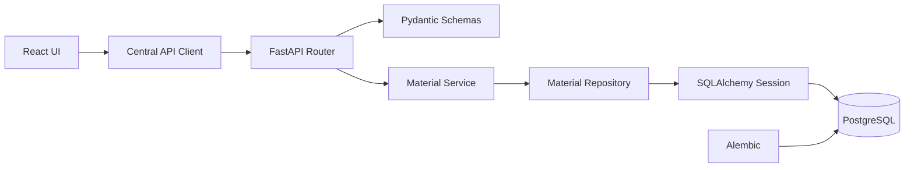

# Foundation — MRP Management System

**Document version:** 1.0  
**Milestone:** Foundation (Milestone 2)  
**Status:** Implementation guide for Antigravity  
**Prerequisite:** Read `docs/Architecture.md` first

---

## 1. Objective

Implement the reliable application foundation before building domain modules. At the end of this milestone:

- The frontend and backend run locally.
- FastAPI is configured through environment settings.
- PostgreSQL is the intended persistent database; SQLite may be used only as a clearly documented local fallback.
- SQLAlchemy sessions and Alembic migrations work.
- A first `Material` entity is persisted through the database.
- Material CRUD endpoints are implemented and tested.
- The React frontend can call the backend through a centralized API client.
- The repository contains clear setup instructions and no committed secrets.

**Do not implement BOM, production planning, inventory transactions, procurement, or the MRP engine in this milestone.**

## 2. Work rules for Antigravity

Before coding:

1. Read `docs/Architecture.md` and this file fully.
2. Inspect the current repository, including `README.md`, dependencies, and existing source files.
3. Preserve the current dashboard and working API health endpoint.
4. Make changes in small, reviewable steps.
5. Do not create duplicate models, database sessions, API clients, or configuration files.
6. Do not use mock data to claim database/API functionality is complete.
7. Do not silently change the selected stack or architecture.
8. If a requirement conflicts with the existing repository, explain the conflict and propose the smallest safe resolution.
9. Never claim a command or test passed unless it was actually executed.
10. Ask before destructive operations, deleting data, or replacing major files.

## 3. Foundation architecture



### Dependency direction

- API endpoints may depend on schemas and services.
- Services may depend on repositories and domain types.
- Repositories may depend on SQLAlchemy models and database sessions.
- Models must not depend on API routes.
- Domain/service code must not depend on React or HTTP request objects.
- Frontend feature code must call the API client, not the database or backend internals.

## 4. Backend configuration

Create a typed configuration module using environment variables.

Required setting:

- `DATABASE_URL`

Recommended settings:

- `APP_NAME`
- `APP_ENV`
- `API_V1_PREFIX`
- `CORS_ORIGINS`
- `SECRET_KEY` (required when authentication is introduced; do not invent or commit a production value)

Rules:

- Provide `.env.example` with safe placeholder values.
- Keep `.env` ignored by Git.
- Do not log credentials or connection strings.
- Validate configuration at startup and fail with a clear message if required settings are missing.
- Use PostgreSQL for the intended project database.
- If SQLite is retained for quick local testing, document its limitations and make the choice explicit in configuration.

## 5. Database and SQLAlchemy

Implement:

- SQLAlchemy 2.x declarative base.
- A single engine configuration module.
- A session factory.
- A FastAPI dependency that yields one session per request and closes it reliably.
- A consistent transaction policy: repositories/services do not leave partially committed operations.
- Alembic configuration connected to the same database settings.

### Required database behavior

- Database sessions must be closed after requests.
- Writes must commit successfully or roll back on failure.
- Avoid creating tables automatically in production startup.
- Use Alembic migrations for schema changes.
- Keep migration files under `backend/alembic/` (or the existing configured migration directory).
- Verify that Alembic autogeneration can detect model changes.

## 6. Material model — first persistent entity

Create a `Material` SQLAlchemy model with the following initial fields:

| Field | Type / rule |
|---|---|
| `id` | Primary key; use the project's chosen ID strategy consistently |
| `material_code` | Required, unique, indexed; trimmed and normalized |
| `name` | Required; non-empty |
| `description` | Optional |
| `category` | Optional string for initial version |
| `unit` | Required; e.g. `pcs`, `kg`, `m`, `litre` |
| `unit_cost` | Decimal, non-negative; never use float for money |
| `lead_time_days` | Integer, non-negative |
| `is_active` | Boolean; default true |
| `created_at` | Timestamp |
| `updated_at` | Timestamp |

Do not add stock quantity to the Material master. Inventory balances and stock movements belong to the future Inventory module.

### Model constraints

- `material_code` must be unique after normalization.
- `name` and `unit` must not be blank.
- `unit_cost >= 0`.
- `lead_time_days >= 0`.
- Prefer deactivation (`is_active = false`) over hard deletion once historical references exist.
- Use database constraints in addition to request validation wherever appropriate.

## 7. Pydantic schemas

Keep API schemas separate from ORM models.

Implement:

- `MaterialCreate`
- `MaterialUpdate`
- `MaterialRead`
- `MaterialList` or a paginated response schema

Validation requirements:

- Trim whitespace from codes and names.
- Reject blank required values.
- Validate non-negative cost and lead time.
- Do not allow client input to set server-managed ID or timestamps.
- Update schema should support partial updates without accidentally resetting omitted fields.
- Response schema should expose only intended public fields.

Use the Pydantic version compatible with the installed FastAPI release and its ORM serialization support.

## 8. Material CRUD API

Base prefix: `/api/v1`

Implement the following routes:

| Method | Endpoint | Expected behavior |
|---|---|---|
| `POST` | `/materials` | Create a material; return `201` |
| `GET` | `/materials` | List materials with pagination and optional search |
| `GET` | `/materials/{material_id}` | Retrieve one material |
| `PATCH` | `/materials/{material_id}` | Partially update a material |
| `DELETE` | `/materials/{material_id}` | Delete only if safe; otherwise return conflict or deactivate |

### API behavior

- Duplicate `material_code` → `409 Conflict`.
- Unknown ID → `404 Not Found`.
- Invalid request → `422 Unprocessable Entity` (FastAPI validation behavior).
- Successful delete → `204 No Content`, if hard deletion is permitted.
- List endpoint should support `skip`/`limit` or equivalent pagination and a `search` parameter.
- Define a maximum page size.
- Sort results consistently (e.g. by material code).
- Keep endpoint handlers thin; delegate logic to service/repository modules.
- Use consistent error response messages without exposing stack traces.

### Recommended files

```text
backend/app/
├── main.py
├── core/
│   └── config.py
├── db/
│   ├── base.py
│   └── session.py
├── api/
│   └── v1/
│       ├── router.py
│       └── endpoints/
│           └── materials.py
├── models/
│   └── material.py
├── schemas/
│   └── material.py
├── repositories/
│   └── material_repository.py
└── services/
    └── material_service.py
```

Adapt to existing files rather than creating duplicate structure.

## 9. Frontend API integration

Create a centralized API client, for example `frontend/src/services/apiClient.js`.

Requirements:

- Use a configurable backend base URL (Vite environment variable such as `VITE_API_BASE_URL`).
- Set JSON headers when sending JSON.
- Parse JSON responses safely.
- Surface useful API error messages to pages.
- Handle network errors and non-2xx responses.
- Do not duplicate raw `fetch()` logic across feature components.

Create the first Materials feature:

- Materials list/table
- Search field
- Add material form
- Edit material form
- Delete/deactivate confirmation
- Loading state
- Empty state
- Error state
- Success feedback
- Basic responsive layout consistent with the existing dashboard

Do not redesign the entire dashboard during this milestone.

## 10. Testing requirements

Use pytest and FastAPI's test client for backend tests.

### Database tests

- Test configuration and session behavior.
- Use a separate test database or isolated SQLite test database.
- Never run tests against real project data.
- Ensure tests clean up after themselves.

### Material service/API tests

At minimum, cover:

1. Create a valid material.
2. Reject blank name/code/unit.
3. Reject negative unit cost.
4. Reject negative lead time.
5. Reject duplicate material code.
6. Read a material by ID.
7. Return 404 for an unknown ID.
8. Update only supplied fields.
9. Search and pagination return expected records.
10. Delete/deactivate behavior is correct.

### Frontend verification

- Build succeeds.
- Materials page can load data from the real API.
- Form validation and API errors are visible.
- Empty and loading states work.
- No console errors are introduced.

## 11. Acceptance criteria

Foundation is complete only when all of these are true:

- [ ] Backend starts from documented commands.
- [ ] Frontend starts from documented commands.
- [ ] `/api/health` returns a healthy response.
- [ ] `/docs` displays the versioned Material API.
- [ ] Database connection is configurable through environment variables.
- [ ] Alembic migration creates the Material table successfully.
- [ ] Material CRUD works against the configured database.
- [ ] Duplicate codes and invalid values are rejected.
- [ ] Frontend Materials page uses the real backend API.
- [ ] Backend tests pass and their command/output is reported.
- [ ] Frontend production build succeeds.
- [ ] README explains setup, migrations, tests, and troubleshooting.
- [ ] `.env`, database files, and secrets are not committed.

## 12. Commands to verify (adapt to actual setup)

Backend:

```bash
cd backend
source .venv/bin/activate
pip install -r requirements.txt
alembic upgrade head
pytest -q
uvicorn app.main:app --reload
```

Frontend:

```bash
cd frontend
npm install
npm run dev
npm run build
```

If a command cannot run because a dependency or service is unavailable, report the exact blocker and the steps needed to resolve it.

## 13. Antigravity task prompt

Use this prompt after adding this file to the repository:

> Read `docs/Architecture.md` and `docs/Foundation.md` fully. Inspect the current repository before changing anything. Implement Foundation milestone only: configuration, SQLAlchemy database/session, Alembic, Material model and schemas, repository/service, versioned CRUD API, frontend API client, Materials UI, and tests. Preserve the existing dashboard and health endpoint. Follow the specified architecture and acceptance criteria. Do not implement BOM, inventory, production, procurement, or MRP calculations yet. Work incrementally, run backend tests and frontend build, and report actual results, changed files, commands, and unresolved issues. Do not claim verification that was not performed.

---

**Milestone boundary:** The output of Foundation is a working application shell plus a database-backed Material Management feature. All subsequent business modules build on this foundation.
