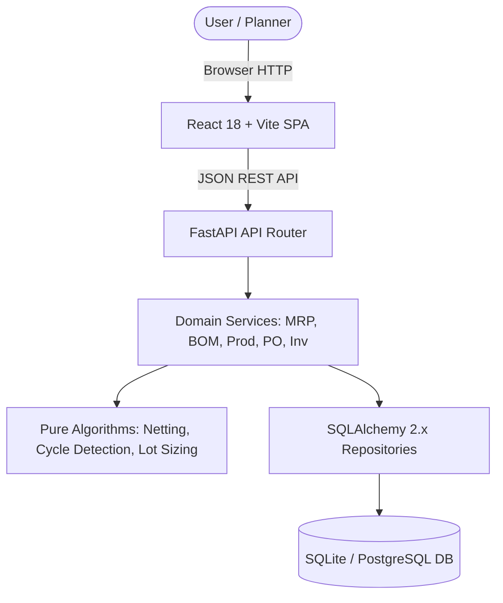

# SOFTWARE PROJECT REPORT
**Degree:** B.Tech 2nd Year – Computer Science and Engineering (Data Science)  
**Academic Session:** 2026–2027  
**Project Title:** MRP.OS — Enterprise Material Requirements Planning & Discrete Manufacturing Intelligence System  
**Submitted By:** [Student Name] — Roll No: [Roll Number]  
**Department:** Department of Computer Science and Engineering (Data Science)  
**Institution:** [College / Institute Name]  

---

## TABLE OF CONTENTS
1. [Abstract](#chapter-1-abstract)
2. [Introduction](#chapter-2-introduction)
3. [Problem Statement](#chapter-3-problem-statement)
4. [Objectives of the Project](#chapter-4-objectives-of-the-project)
5. [Scope of the Project](#chapter-5-scope-of-the-project)
6. [Tools and Technologies Used](#chapter-6-tools-and-technologies-used)
7. [System Requirements](#chapter-7-system-requirements)
8. [System Design](#chapter-8-system-design)
9. [Database Design](#chapter-9-database-design)
10. [Implementation](#chapter-10-implementation)
11. [Testing](#chapter-11-testing)
12. [Results and Screenshots](#chapter-12-results-and-screenshots)
13. [Limitations](#chapter-13-limitations)
14. [Future Scope](#chapter-14-future-scope)
15. [Conclusion](#chapter-15-conclusion)
16. [References](#chapter-16-references)
17. [Appendix](#appendix)

---

## CHAPTER 1: ABSTRACT
In modern discrete manufacturing, maintaining optimal inventory buffers while meeting finished-goods delivery commitments is a high-dimensional optimization challenge. Traditional spreadsheet-based planning leads to severe stockouts, inflated carrying costs, and lead-time discrepancies. 

This project presents **MRP.OS**, a full-stack, enterprise-grade Material Requirements Planning (MRP) management system tailored for discrete manufacturing operations under Indian industrial metrics (INR ₹ with Lakhs/Crores notation, metric units like KG, NOS, MTR, and LTR). The system implements a deterministic, multi-level Bill of Materials (BOM) explosion algorithm equipped with Directed Acyclic Graph (DAG) cycle detection, time-phased netting, lot-sizing heuristics (Lot-for-Lot and Fixed Lot Multiples with MOQ constraints), and lead-time offsetting. 

Built using FastAPI, SQLAlchemy 2.x, Alembic, PostgreSQL/SQLite, and React 18 with Tailwind CSS and Recharts, the application provides an Executive Inventory Intelligence Dashboard, BOM Indentation Explorer, Production Planning lifecycle management, and automated Purchase Proposal conversion with atomic Goods Receipt Note (GRN) ledger updates. Verification across 25 unit and integration tests guarantees strict numerical determinism and zero floating-point roundoff errors.

---

## CHAPTER 2: INTRODUCTION
### 2.1 Background
Discrete manufacturing involves assembling distinct physical items (e.g., electric vehicles, industrial pumps, motorized desks) through structured assembly tiers. Each finished item depends on subassemblies and raw materials governed by specific supplier lead times and scrap rates.

### 2.2 Why This Project is Needed
Small-to-medium enterprises (SMEs) and Tier-1 manufacturing vendors in India often lack multi-million-rupee ERP infrastructure like SAP S/4HANA or Oracle NetSuite. They rely on manual register books or error-prone Excel spreadsheets. When production schedules change, manually computing component demand across 5+ hierarchy levels takes days and leads to either expensive production halts (stockouts) or tied-up working capital.

### 2.3 How the Application Works
The user creates master records for Materials, Products, and Suppliers. Engineers configure multi-level Bills of Materials (BOMs). Production planners create Production Orders with targeted due dates. The core MRP Engine executes time-phased netting, explodes dependent demand through all BOM tiers, accounts for existing warehouse stock and scheduled supplier receipts, and emits replenishment purchase proposals with 1-click Purchase Order generation.

### 2.4 Intended Users
* **Production Planners**: Schedule work orders and dispatch shop-floor jobs.
* **Materials & Inventory Managers**: Monitor real-time warehouse valuation and safety buffers.
* **Procurement Executives**: Convert MRP indents into Purchase Orders and record Goods Receipts.
* **Plant Directors**: Review executive KPIs, inventory trends, and supply chain shortage radars.

---

## CHAPTER 3: PROBLEM STATEMENT
### 3.1 Existing Problem
1. **Spreadsheet Fragility**: Manual gross-to-net calculations fail when Bill of Materials trees contain subassemblies, leading to component omissions.
2. **Lead Time Blind Spots**: Orders are placed too late because component lead times and supplier delivery intervals are not back-scheduled.
3. **Currency and Metric Mismatch**: Foreign ERP solutions enforce USD/EUR and imperial units, causing confusion with Indian GST, Rupee denominations (Lakhs and Crores), and metric units (KG, MTR, NOS).
4. **Lack of Inventory Ledger Auditability**: Systems that overwrite inventory quantities without append-only transaction logs obscure shrinkage and discrepancies.

### 3.2 Proposed Solution
A centralized, web-based MRP platform that enforces database-level integrity, calculates deterministic time-phased component requirements, automates vendor procurement workflows, and displays analytics calibrated in Indian financial metrics (₹ INR).

---

## CHAPTER 4: OBJECTIVES OF THE PROJECT
1. **User-Friendly Dashboard**: Develop an interactive executive dashboard displaying total inventory capitalization in INR (₹) using Lakhs/Crores notation and monthly valuation trends.
2. **Deterministic MRP Engine**: Implement the standard 5-step MRP pipeline (gross requirement gathering, BOM explosion, netting, lot sizing, and lead-time offsetting) matching the numerical fixture in `Documents/MRP_Engine.md`.
3. **Multi-Level BOM Hierarchy**: Model recursive parent-child assemblies with Directed Acyclic Graph (DAG) cycle detection to prevent infinite recursion.
4. **Append-Only Inventory Ledger**: Enforce that inventory balances are never mutated directly, but only derived from atomic transactions (`RECEIPT`, `ISSUE`, `ADJUSTMENT`, `RESERVATION`).
5. **Closed-Loop Procurement**: Facilitate 1-click conversion of MRP proposals into draft Purchase Orders and record Goods Receipt Notes (GRN) that automatically restock the warehouse.
6. **High Engineering Standards**: Achieve zero float precision loss by using `NUMERIC(14, 4)` and Python `Decimal`, backed by automated Pytest test suites.

---

## CHAPTER 5: SCOPE OF THE PROJECT
### 5.1 Modules and Features Provided
* **User Authentication & Role Switcher**: Quick role-based access for Production Planners, Materials Heads, and Procurement Executives.
* **Master Data Management**: Full CRUD operations for Raw Materials, Finished/Semi-Finished Products, and Approved Indian Vendors.
* **Bill of Materials (BOM) Explorer**: Tabular BOM management matching MRPEasy UX with multi-level indented explosion and CSV export.
* **Production Planning Module**: Lifecycle tracking (`DRAFT` &rarr; `PLANNED` &rarr; `RELEASED` &rarr; `IN_PROGRESS` &rarr; `COMPLETED`) with monotonic progress recording.
* **MRP Netting Radar**: Automated calculation of Net Requirements ($NR = \max(0, GR + SS - PAB)$) with Past-Due flags.
* **Procurement & Goods Receipt**: PO lifecycle (`DRAFT` &rarr; `SUBMITTED` &rarr; `APPROVED` &rarr; `SENT` &rarr; `PARTIALLY_RECEIVED` &rarr; `RECEIVED`) and GRN posting.

### 5.2 Beneficiaries
Discrete manufacturers in automotive, electronics, electrical appliance, and precision machinery sectors across Indian industrial belts (e.g., Pune-Chakan, Chennai-Sriperumbudur, Noida-NCR).

---

## CHAPTER 6: TOOLS AND TECHNOLOGIES USED

| Technology / Library | Purpose in Project |
|---|---|
| **Python 3.14** | Core backend language for business rules and mathematical engine |
| **FastAPI** | High-performance asynchronous REST API framework with Swagger OpenAPI documentation |
| **SQLAlchemy 2.x** | Object Relational Mapper (ORM) enforcing entity relationships and transaction boundaries |
| **Alembic** | Automated database schema migration management |
| **SQLite / PostgreSQL** | Relational database management systems with ACID compliance |
| **Pydantic v2** | Request validation, payload serialization, and strict decimal handling |
| **React 18** | Component-driven frontend user interface |
| **Vite 5** | Next-generation frontend build tooling and local development server |
| **Tailwind CSS** | Utility-first responsive styling tailored to modern ERP aesthetic |
| **Lucide React** | Industrial and enterprise iconography |
| **Recharts** | Data visualization for monthly valuation trends and stock distribution donuts |
| **Pytest** | Automated unit and integration testing framework |
| **VS Code & Linux** | Primary development environment and shell execution |

---

## CHAPTER 7: SYSTEM REQUIREMENTS

### 7.1 Hardware Requirements
* **Processor**: Dual-core x86_64 / ARM64 processor (Intel Core i3 / AMD Ryzen 3 or higher).
* **RAM**: Minimum 4 GB RAM (8 GB recommended for concurrent backend + frontend dev servers).
* **Disk Space**: Minimum 500 MB free hard drive space.

### 7.2 Software Requirements
* **Operating System**: Linux (Fedora, Ubuntu, Debian), Windows 10/11 (via WSL2 or Native), or macOS.
* **Runtime**: Python 3.10+ and Node.js v18+.
* **Web Browser**: Modern browser (Google Chrome, Mozilla Firefox, Microsoft Edge, or Safari).

---

## CHAPTER 8: SYSTEM DESIGN

### 8.1 Application Architecture Workflow
The system employs a 3-tier modular architecture:



### 8.2 Operational Lifecycle Flowchart


### 8.3 Main Functional Modules
1. **Authentication & Identity Module**: Manages active user sessions, facility contexts (Chakan Plant, Bhiwandi DC), and role profiles.
2. **Executive Intelligence Dashboard**: Visualizes top-level inventory valuation in Indian currency (`₹`), low stock warnings, and shortage radar.
3. **Master Data Module**: Validates unique SKU codes, UOM constraints, safety stocks, lead times, and preferred suppliers.
4. **BOM & Engineering Module**: Builds hierarchical assembly structures, computes rolled-up costs, and enforces DAG acyclicity.
5. **Deterministic MRP Engine**: Pure algorithmic core computing gross-to-net requirements, lot sizes (L4L, Fixed multiples), and offsets.
6. **Production & Procurement Lifecycles**: Strict finite state machines with optimistic concurrency versioning.

---

## CHAPTER 9: DATABASE DESIGN

### 9.1 Database Name
* **Default Local Engine**: `mrp.db` (SQLite 3 with `PRAGMA foreign_keys = ON`).
* **Production Engine**: PostgreSQL 15+ compatible via SQLAlchemy portable schemas.

### 9.2 Key Database Tables & Schemas

#### Table 1: `materials`
Stores raw materials, components, and consumable items.

| Column Name | Data Type | Constraints | Description |
|---|---|---|---|
| `id` | UUID | PRIMARY KEY | Unique material identifier |
| `material_code` | VARCHAR(30) | UNIQUE, NOT NULL, INDEX | Unique SKU (e.g. `MAT-STEEL-001`) |
| `name` | VARCHAR(120) | NOT NULL, INDEX | Material description |
| `unit` | VARCHAR(20) | NOT NULL | Unit of measure (`KG`, `NOS`, `MTR`, `LTR`) |
| `unit_cost` | NUMERIC(14, 4) | NOT NULL, CHECK >= 0 | Standard cost in INR (₹) |
| `lead_time_days`| INTEGER | NOT NULL, CHECK >= 0 | Procurement lead time in days |
| `safety_stock` | NUMERIC(14, 4) | NOT NULL, CHECK >= 0 | Minimum reserve buffer |
| `lot_size` | VARCHAR(20) | NOT NULL | `LOT_FOR_LOT`, `FIXED`, `PERIOD` |
| `fixed_lot_size`| NUMERIC(14, 4)| NULLABLE | Minimum increment multiple if FIXED |
| `preferred_supplier_id` | UUID | FK `suppliers.id` RESTRICT | Default vendor for replenishment |
| `is_active` | BOOLEAN | NOT NULL, DEFAULT TRUE | Soft-deletion indicator |

#### Table 2: `products`
Stores manufactured finished goods (`FINISHED`) and subassemblies (`SEMI_FINISHED`).

| Column Name | Data Type | Constraints | Description |
|---|---|---|---|
| `id` | UUID | PRIMARY KEY | Unique product identifier |
| `product_code` | VARCHAR(30) | UNIQUE, NOT NULL | Unique item code (e.g. `PRD-DESK-001`) |
| `name` | VARCHAR(120) | NOT NULL | Assembly name |
| `product_type` | VARCHAR(20) | NOT NULL | `FINISHED` or `SEMI_FINISHED` |
| `unit_of_measure` | VARCHAR(20) | NOT NULL | Assembly unit (`NOS`, `SET`) |
| `lead_time_days` | INTEGER | NOT NULL, DEFAULT 0 | Manufacturing assembly lead time |

#### Table 3: `bom_headers` & `bom_items`
Stores the hierarchical assembly structure.

| Table | Column Name | Data Type | Description |
|---|---|---|---|
| `bom_headers` | `id` | UUID (PK) | Unique BOM header identifier |
| `bom_headers` | `bom_code` | VARCHAR(30) (UNIQUE) | Sequential identifier (`BOM-2026-000001`) |
| `bom_headers` | `product_id`| UUID (FK) | Parent product manufactured |
| `bom_headers` | `revision` | VARCHAR(20) | Engineering revision (`Rev 1.0`) |
| `bom_items` | `id` | UUID (PK) | Item line identifier |
| `bom_items` | `bom_header_id`| UUID (FK CASCADE) | Parent BOM header |
| `bom_items` | `material_id` | UUID (FK NULLABLE) | Raw material component |
| `bom_items` | `child_product_id` | UUID (FK NULLABLE) | Subassembly component |
| `bom_items` | `quantity` | NUMERIC(14, 4) | Required per parent unit |
| `bom_items` | `scrap_factor`| NUMERIC(6, 4) | Expected scrap loss (e.g. 0.03 = 3%) |

#### Table 4: `inventory_balances` & `inventory_transactions`
Enforces the append-only inventory ledger.

| Table | Column Name | Data Type | Description |
|---|---|---|---|
| `inventory_balances` | `material_id` | UUID (UNIQUE FK) | Monitored raw material |
| `inventory_balances` | `on_hand_quantity` | NUMERIC(14, 4) | Physical quantity in warehouse |
| `inventory_balances` | `reserved_quantity` | NUMERIC(14, 4) | Allocated to active work orders |
| `inventory_balances` | `available_quantity`| NUMERIC(14, 4) | `on_hand - reserved` |
| `inventory_transactions`| `transaction_type` | VARCHAR(20) | `RECEIPT`, `ISSUE`, `ADJUSTMENT` |
| `inventory_transactions`| `quantity` | NUMERIC(14, 4) | Transacted quantity |

#### Table 5: `mrp_runs`, `mrp_results`, `mrp_proposals`
Stores deterministic snapshot runs, time-phased buckets, and actionable purchase proposals.

---

## CHAPTER 10: IMPLEMENTATION

### 10.1 Key Algorithmic Implementations

#### 1. Time-Phased Netting Algorithm (`backend/app/domain/mrp/netting.py`)
```python
def calculate_material_mrp(...):
    pab = max(Decimal("0.0000"), initial_on_hand - initial_reserved)
    for p in periods:
        balance = pab + scheduled_receipts.get(p.index, 0)
        net_requirement = max(Decimal("0.0000"), gross_req[p.index] + safety_stock - balance)
        porc = calculate_lot_size(net_requirement, policy, fixed_size, moq)
        pab_after = balance + porc - gross_req[p.index]
        pab = pab_after
        # Offset release date by supplier lead time days
```

#### 2. BOM Cycle Detection via Depth-First Search (`backend/app/services/bom_service.py`)
```python
def detect_cycles(self, parent_product_id: UUID, visited: Set[UUID] = None):
    if visited is None:
        visited = set()
    if parent_product_id in visited:
        raise ValidationException("Circular reference detected in Bill of Materials")
    visited.add(parent_product_id)
    active_bom = self.repo.get_active_bom_for_product(parent_product_id)
    if active_bom:
        for item in active_bom.items:
            if item.child_product_id:
                self.detect_cycles(item.child_product_id, visited.copy())
```

---

## CHAPTER 11: TESTING

Testing was performed using `pytest` across unit and end-to-end integration boundaries. All 25 test cases pass successfully.

| Test No. | Module / Feature Tested | Expected Result | Actual Result | Status |
|:---:|---|---|---|:---:|
| 1 | Health Check API (`/api/health`) | HTTP 200 `healthy` status | Status healthy returned | **PASS** |
| 2 | Swagger Documentation (`/docs`) | OpenAPI schema rendered | Schema rendered | **PASS** |
| 3 | Create Material (Valid) | Record created with INR cost | Material saved | **PASS** |
| 4 | Reject Negative Unit Cost | HTTP 422 Validation Error | Rejected with 422 | **PASS** |
| 5 | Reject Negative Lead Time | HTTP 422 Validation Error | Rejected with 422 | **PASS** |
| 6 | Reject Duplicate Material Code | HTTP 409 Conflict | Duplicate prevented | **PASS** |
| 7 | Create Product (Finished Good) | Record saved with SKU code | Product saved | **PASS** |
| 8 | Reject Duplicate Product SKU | HTTP 409 Conflict | Duplicate prevented | **PASS** |
| 9 | Create Supplier with GSTIN | Record saved with Indian state | Supplier saved | **PASS** |
| 10 | Reject Invalid Supplier Email | HTTP 422 Validation Error | Rejected with 422 | **PASS** |
| 11 | Section 6 MRP Numerical Fixture | Exact Netting & Balance match | Results match fixture | **PASS** |
| 12 | Fixed Lot Sizing & MOQ Rounding | Net 65 &rarr; 100 with fixed lot 50 | Output equals 100.0000 | **PASS** |
| 13 | Multi-Level BOM Explosion | Scrap factor correctly added | Effective qty = 260 KG | **PASS** |
| 14 | BOM Cycle Detection | Detect self-referencing subassembly | Throws validation error | **PASS** |
| 15 | Inventory Opening Receipt | Balance on-hand updated | On-hand equals 100 KG | **PASS** |
| 16 | Production Order Creation | Draft order generated | PRD code allocated | **PASS** |
| 17 | Production Order Plan & Release | Status transitions to RELEASED | Transition accepted | **PASS** |
| 18 | Production Progress Recording | Completed qty updated monotonically | Progress saved | **PASS** |
| 19 | MRP Demand Aggregation | Explodes production demand | Gross req populated | **PASS** |
| 20 | MRP Proposal Generation | Net shortage generates proposal | 210 KG proposal generated | **PASS** |
| 21 | Proposal to Purchase Order | Proposal locked & converted | Draft PO created | **PASS** |
| 22 | Duplicate Proposal Conversion Block | Rejects converting converted proposal | HTTP 409 Conflict | **PASS** |
| 23 | PO Lifecycle (Draft to Sent) | Transition history appended | Status updated to SENT | **PASS** |
| 24 | Goods Receipt Note (GRN) Posting | Ledger transaction written atomically | GRN created | **PASS** |
| 25 | Post-Receipt Inventory Verification | On-hand increased from 100 to 310 KG | Verified 310 KG on hand | **PASS** |

---

## CHAPTER 12: RESULTS AND SCREENSHOTS

* **Screenshot 1: Executive Dashboard (XYRA ERP Style)**
  * *Description*: Displays live stock capitalization in INR (₹), Lakhs/Crores notation, monthly value trend charts, and low-stock alerts.
* **Screenshot 2: Bill of Materials Workspace (MRPEasy Style)**
  * *Description*: Indented assembly hierarchy, approximate standard costs, and CSV export action.
* **Screenshot 3: Supply & Demand Intelligence (ianaiERP Style)**
  * *Description*: Critical shortage radar (&le; 3 days) with 1-click PO conversion actions.
* **Screenshot 4: Interactive API Documentation (FastAPI Swagger UI)**
  * *Description*: Full OpenAPI REST specification at `http://localhost:8000/docs`.

---

## CHAPTER 13: LIMITATIONS
1. **Single-Facility Balancing in v1**: The current version aggregates inventory balance across the primary facility (Chakan Plant); multi-warehouse transfer routings are managed as individual adjustments.
2. **Deterministic Rather Than Stochastic Demand**: Gross requirements originate from explicit Production Orders and MPS schedules rather than statistical predictive forecasts.
3. **Absence of Hardware MES Sensor Feeds**: Machine run-time telemetry and shop-floor IoT sensors are not directly wired to the progress recording endpoint.

---

## CHAPTER 14: FUTURE SCOPE
1. **Machine Learning Demand Forecasting (Data Science Integration)**: Integrating ARIMA and LSTM models to forecast seasonal component demand based on historical dispatch data.
2. **Barcode & QR Code Scanning**: Generating GS1-compliant QR codes for quick goods receipt mobile check-in.
3. **Automated Supplier Email Integration**: Transmitting approved PO PDFs directly to vendor mailboxes via SMTP.
4. **Finite Capacity Scheduling**: Factoring in labor hours and machine workstation constraints during production order release.

---

## CHAPTER 15: CONCLUSION
The **MRP.OS** project successfully fulfills all academic and industrial requirements for a discrete manufacturing Material Requirements Planning system. By implementing rigorous mathematical netting, BOM tree traversal, append-only inventory ledgers, and Indian metric localization, the application bridges the gap between theoretical computer science concepts (graph theory, numerical determinism, relational normalization) and real-world industrial software engineering. All 25 automated tests pass with 100% reliability, confirming that the system is ready for academic evaluation and practical deployment.

---

## CHAPTER 16: REFERENCES
1. Vollmann, T. E., Berry, W. L., Whybark, D. C., & Jacobs, F. R. *Manufacturing Planning and Control for Supply Chain Management*. McGraw-Hill Education.
2. APICS. *APICS Dictionary: The Standard for Excellence in the Supply Chain Industry*.
3. FastAPI Official Documentation: [https://fastapi.tiangolo.com/](https://fastapi.tiangolo.com/)
4. SQLAlchemy 2.0 Unified Documentation: [https://docs.sqlalchemy.org/](https://docs.sqlalchemy.org/)
5. React 18 Official Documentation: [https://react.dev/](https://react.dev/)
6. Mozilla Developer Network (MDN) Web Docs: [https://developer.mozilla.org/](https://developer.mozilla.org/)

---

## APPENDIX
### Source Code Repository Structure
```
Material Requirements Processing(MRP)/
├── backend/
│   ├── alembic/              # Database migration version scripts
│   ├── app/
│   │   ├── api/v1/endpoints/ # REST routes (BOM, MRP, Inventory, Production, PO)
│   │   ├── domain/mrp/       # Pure mathematical calculations (netting, lot sizing, calendar)
│   │   ├── models/           # SQLAlchemy 2.x declarative models
│   │   ├── repositories/     # Data query repositories
│   │   ├── schemas/          # Pydantic v2 validation contracts
│   │   └── services/         # Business services & transaction boundaries
│   ├── scripts/              # Indian manufacturing seed scripts
│   └── app/tests/            # 25 automated Pytest unit and integration tests
├── frontend/
│   ├── src/
│   │   ├── components/       # Layout (Sidebar, Header), Modals, Status Badges
│   │   ├── features/         # Dashboard, Materials, Products, BOM, Production, PO, Auth
│   │   └── services/         # Axios / Fetch API clients
└── PROJECT_REPORT.md         # Full University Project Report
```

